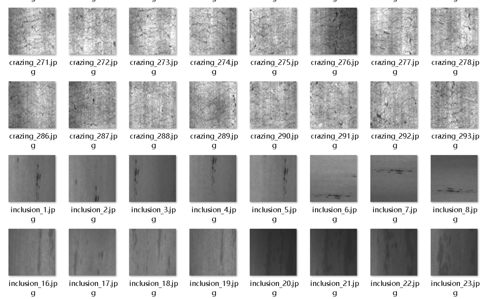
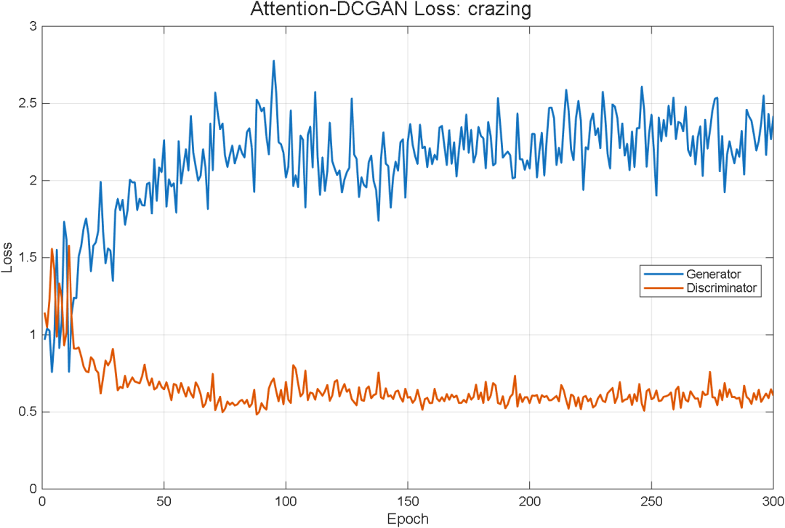
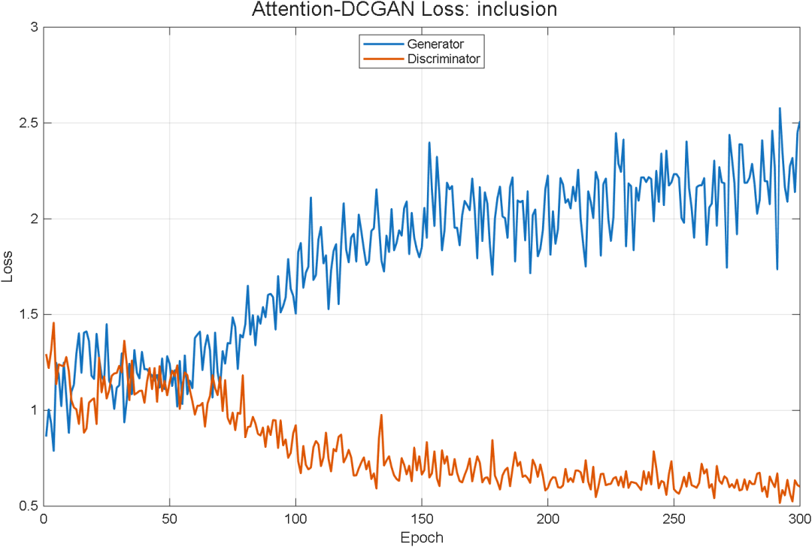
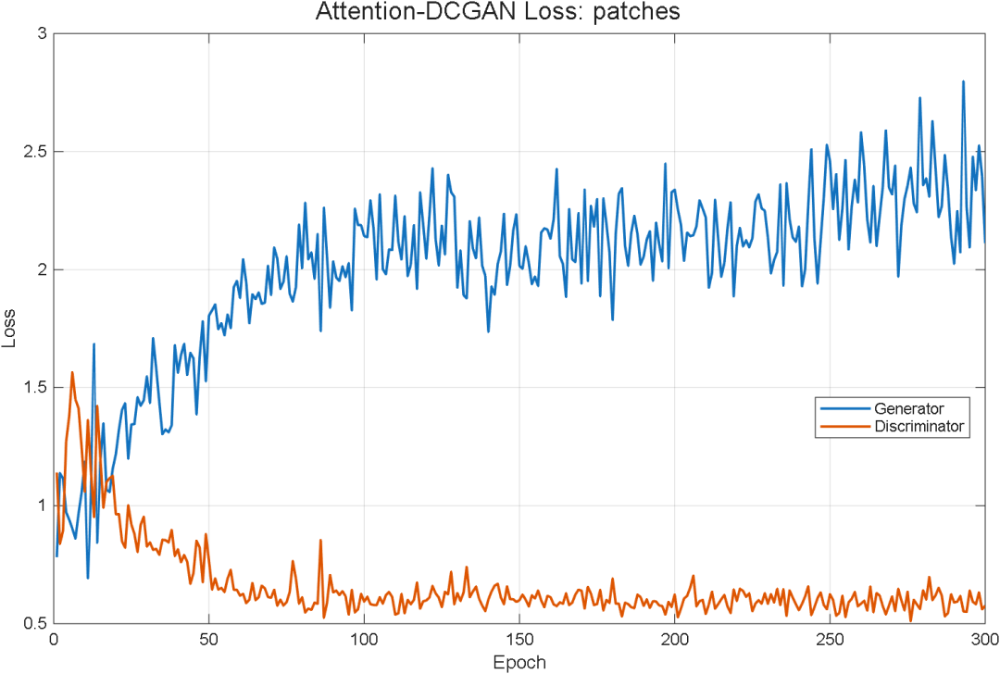
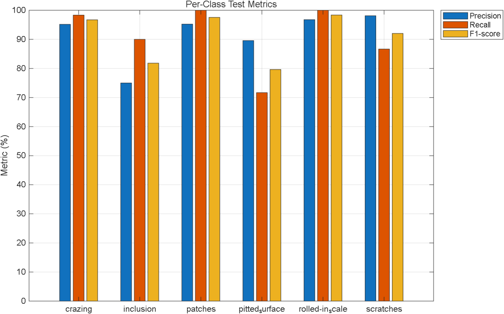
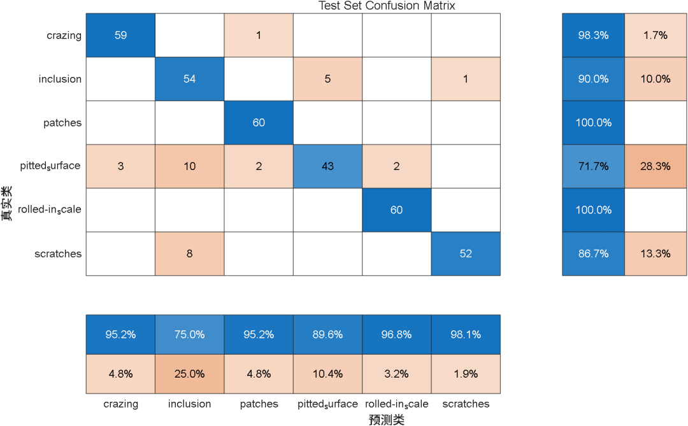
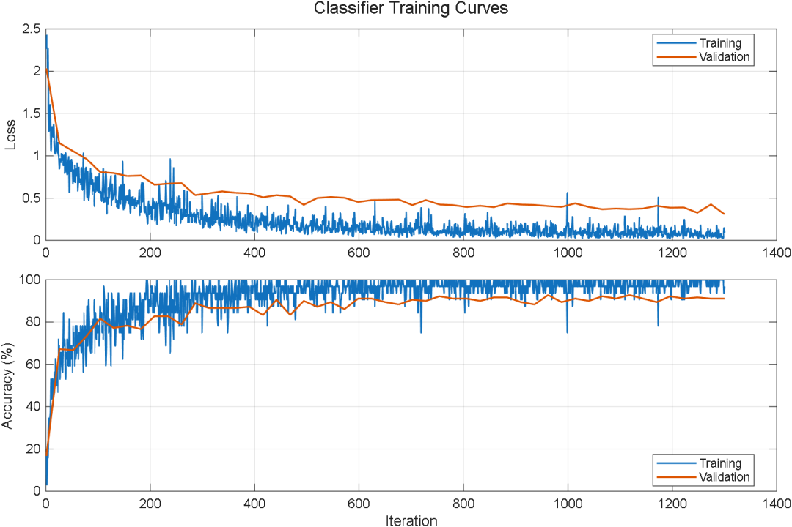
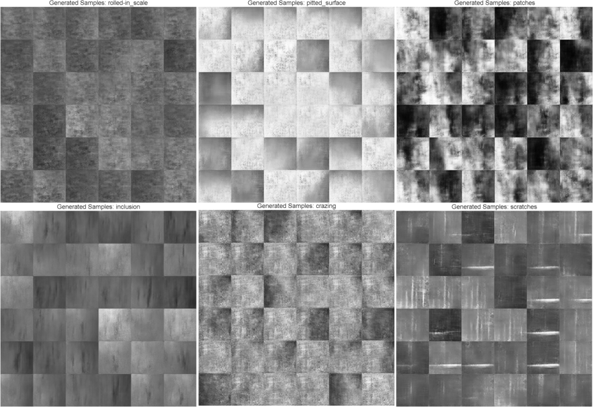

# Surface Defect Identification of Steel with Few Samples Based on Attention-Enhanced DCGAN

This issue contains MATLAB code!
In the steel production process, surface defects such as cracks, scratches, inclusions, and pitting can affect the appearance, machinability, and final quality of the product.
Deep learning has achieved good results in identifying surface defects on steel products. However, in real industrial scenarios, defect samples are usually scarce, and some defects are even difficult to continuously collect. Insufficient sample quantity can lead to overfitting of the recognition model, and its ability to judge new images will decrease.
This tweet introduces a project based on attention-enhanced DCGAN for the identification of few-shot steel surface defects.
The entire project implementation is as follows:
1. This project constructs a few-shot scenario based on the NEU dataset, containing only 30 real images per class, and trains an attention-enhanced DCGAN for generating supplementary samples for six types of defects: cracking, inclusions, patches, pitted surfaces, rolled-in oxide scale, and scratches. After generating images and selecting real samples with weights, the project builds an enhanced training set and trains a lightweight defect classification network. Finally, it achieves a classification accuracy of 91.11% on 360 real test images, forming a complete experimental process from data partitioning, defect image generation, training set expansion to classification evaluation.
1. What kind of steel defect data was used? The project uses the publicly available NEU Surface Defect Database. This dataset was created by the team led by Song Kecheng at Northeastern University, comprising 1800 images of steel surface defects and labels, covering six common defect types.
• Crazing: Cracking;
• Inclusions: Inclusions;
• Patches: Patches;
• Pitted_surface: Pitted surface;
• Rolled-in_scale: Rolled-in oxide scale;
• Scratches: Scratches.
Each category originally contained 300 images.
The original dataset looked like this:
The experiment first divides the data into training set, validation set and test set. Then it randomly selects 30 images from each class of training data to construct a small sample training set.
The final data partition is as follows:
Data usage
Number of images per category
Original image
300  
Training candidate set
210  
Few-shot training set
30  
Validation set
30  
Test set
60  
The test set always only uses real images, without including generated images.
II. The overall project process is completed in the following five steps.
STEP 1: Building a few-shot dataset And classify the training set according to categories. Validation set and test set. Subsequently, 30 real images are randomly selected from each category of training set. As a follow-up to generate models and classifier models with few samples. All stochastic processes are seeded with a fixed random number. Thus, ensure that the same data partition is used for each experiment.
STEP 2: Train attention-enhanced DCGANs for six types of steel defects, respectively training six attention-enhanced DCGANs (code supports SE attention and CBAM attention).
Each generation model learns only one defect category. For example:
• Crazing Generates a model that only learns from crack images.
• scratches Generate a model that only learns scratch images.
• pitted_surface Generates a model that only learns images of pitted surfaces.
The model incorporates a lightweight attention mechanism, allowing the network to focus more on features related to defect morphology.
Since each category only has 30 training images, The project also balances the training process of generator and discriminator. Avoid over-learning by the discriminator. Causes the generator to be unable to continue improving.
Each model's training curve:
There are three categories of LOSS curves, which will not be displayed one by one.
STEP 3: Generating and filtering defect images
For each category, 240 candidate images are first generated, and then 80 of them are selected from the candidate pool based on image quality to serve as the final enhanced samples.
The filtered generated images will be mixed with real few-shot images to form a new enhanced training set.
STEP 4: Train a light convolutional neural network using the enhanced training set to classify steel defects. During the training process, monitor the model's performance with an independent validation set and save the model with the best validation results, thereby reducing overfitting's impact on the final results.
After the model training is completed, use a real test set that has never been involved in training for evaluation.
The project calculated the following indicators:
• Classification accuracy;
• Precision;   
• Recall;   
• F1-score;   
• Various category identification results;
• Confusion matrix.
Training curves, sample plots and class indicator plots are generated simultaneously to analyze the model's training status and recognition performance.
IV. Image Generation Effect After training, different categories of generative models can produce grayscale images with corresponding defect features.
For example:
• scratches Directional lines with obvious scratches in the image;
• patches image presents as large area of irregular light and dark areas;
• inclusion The image contains fine, dark lines and local inclusions.
• pitted_surface The image can observe fine, scattered dots.
• rolled-in_scale The image presents a relatively continuous rough surface texture.
Attention-DCGAN generated scratch samples
V. Final classification results are evaluated on 360 real test images.
The overall results are as follows:
Evaluation indicators
Experimental results
Test set accuracy
91.11%  
Macro Precision  
91.65%  
Macro Recall  
91.11%  
Macro F1-score  
91.02%  
Best validation accuracy  
92.78%  
Test results for various categories are as follows:  
Defect category  
Precision  
Recall  
F1-score  
crazing  
95.16%  
98.33%  
96.72%  
inclusion  
75.00%  
90.00%  
81.82%  
patches  
95.24%  
100.00%  
97.56%  
pitted_surface  
89.58%  
71.67%  
79.63%  
rolled-in_scale  
96.77%  
100.00%  
98.36%  
scratches  
98.11%  
86.67%  
92.04%  
Among them:  
• patches has a recall rate of 100%;  
• rolled-in_scale has a recall rate of 100%;  
• crazing has a recall rate of 98.33%;  
• scratches has an F1-score of 92.04%.  
The most challenging defect to identify is pitted_surface, with a recall rate of 71.67%. This category is mainly confused with inclusion, indicating that the pitted surface and inclusion still have some similarities in some local textures.

## Images

<!-- PAYMENT_BLOCK -->

## Get this dataset

- Payment link (Stripe): [Buy now](https://buy.stripe.com/3cs8yP7sY87d0vu9AB)
- Payment QR code: 

<!-- /PAYMENT_BLOCK -->
